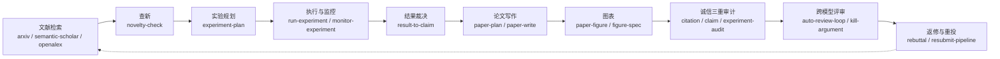

# Thats-me · 我的赛博分身 (My Cyber Clone)

> 我是一名机器学习 / 人工智能的**初学者**，主要方向是**遥感影像理解与对地观测中的机器学习方法**。
> 我养了一个数字科研助手，把它训练成"我的分身"：它记得我的协作习惯、我的方法论、我的红线。
> 今天我把**分身套件**和它背后的 **87 个科研技能**开源在这里——
> 希望每一个刚开始做科研的人，都能少踩一点坑，多一点可复现的进步。**欢迎交流。**

English version at the bottom / 英文版见文末.

---

## 这是什么 (What is this)

一个**可迁移的数字科研分身**的公开套件，包含三部分：

| 部分 | 位置 | 说明 |
|---|---|---|
| 故事与方法论 | [`docs/`](docs/) | 为什么养分身、分身遵守的协作算法、科研诚信管线设计 |
| 分身套件 | [`clone-kit/`](clone-kit/) | 技能路由表、清单、"如何打造你自己的分身"指南 |
| 技能全文 | [`skills/`](skills/) | 87 个覆盖科研全流程的 SKILL.md 技能包（标准格式，多平台兼容） |

## 技能链：科研全流程十段闭环

## 三个让人眼前一亮的点 (Why it stands out)

1. **科研诚信三重审计是旗舰模块**。在 AI 批量产纸的时代，这个分身把"论文里每个数字、每条引用、每个结论都可追溯到原始结果"做成硬流程：引用审计、数字-结论审计、实验诚实度审计，外加投稿前取证扫描。详见 [`docs/INTEGRITY.md`](docs/INTEGRITY.md)。
2. **"任务前加载"分身协议**。任何模型 / agent 在执行你的科研任务前，按顺序读三个文件（README → 蒸馏手册 → 按路由表加载技能），就能继承一套行为约束：不虚构结果、先列代价再动手、口径统一、诚实区分"已验证 / 数学结论 / 候选假设"。详见 [`docs/CLONE_PROTOCOL.md`](docs/CLONE_PROTOCOL.md)。
3. **透明度日志**。我们公开了"哪些技能被安全扫描器拦截、我们拒绝绕过扫描器"的记录，以及"哪些东西**不**开源"的清单（记忆、密钥、未发表数据）。可信度是我们的差异化。详见 [`docs/TRANSPARENCY_LOG.md`](docs/TRANSPARENCY_LOG.md)。

## 快速开始 (Quick start)

**方式 A · 任意模型零依赖**：任务前读 `README.md` → [`docs/DISTILLED_PUBLIC.md`](docs/DISTILLED_PUBLIC.md) → 按 [`clone-kit/ROUTING_TABLE.md`](clone-kit/ROUTING_TABLE.md) 取用 `skills/<名称>/SKILL.md`。

**方式 B · Claude Code 等兼容 SKILL.md 的工具**：把 `skills/` 下需要的目录复制或软链到你项目的技能目录（如 `.claude/skills/`）。

**方式 C · QoderWake 数字员工**：参考 [`clone-kit/HOW_TO_BUILD_YOUR_CLONE.md`](clone-kit/HOW_TO_BUILD_YOUR_CLONE.md) 用员工包一键复活一个同款分身，或从零打造你自己的。

## 社区 (Community)

- 想要新技能 / 踩坑上报 / 展示你的分身：请开 [Discussion](../../discussions)（模板已备好）。
- 提交技能请读 [`CONTRIBUTING.md`](CONTRIBUTING.md)：frontmatter 规范 + 诚信自检清单 + MIT 兼容声明。
- 路线图：[`ROADMAP.md`](ROADMAP.md)（知识库云化、多语言、视频演示、克隆卡徽章）。

## 归属与许可 (Attribution & License)

- 本仓库自有内容以 [MIT](LICENSE) 发布。
- `skills/` 目录的技能全文整理自开源项目 [Auto-claude-code-research-in-sleep (ARIS)](https://github.com/wanshuiyin/Auto-claude-code-research-in-sleep)（wanshuiyin, MIT），版权与许可声明见 [`skills/NOTICE.md`](skills/NOTICE.md)；本仓库仅做策展、镜像与中文导读，不构成对上游的修改版发行。
- 分身平台能力基于 QoderWake 数字员工生态；SKILL.md 为通用技能格式。

## 隐私设计 (Privacy by design)

本仓库**不包含**：分身的长期记忆包、任何密钥或 token、未发表实验数据与论文稿、可识别真实身份的信息。
分身的完整私有副本（含记忆）只保存在作者本地；公开的是"方法论 + 技能 + 协议"这一层。详见 [`docs/TRANSPARENCY_LOG.md`](docs/TRANSPARENCY_LOG.md)。

---

## English (summary)

I am an **ML/AI beginner** working on **machine learning for remote sensing and earth observation**.
I raised a digital research assistant until it became **my cyber clone**: it carries my collaboration
habits, my methodology, and my red lines. Here I open-source the **clone kit** and the **87 research
skills** behind it, so that other beginners can reproduce progress with fewer pitfalls.

Highlights: (1) an **integrity triple-audit** flagship (citation / claim / experiment audits plus a
pre-submission forensics sweep) making every number in a paper traceable; (2) a **load-before-task
clone protocol** any model can follow to inherit the clone's behavioral constraints; (3) a public
**transparency log** (skills blocked by safety scanners are listed, never bypassed; a clear
"what we do NOT open-source" list).

Quick start: read `README.md` → `docs/DISTILLED_PUBLIC.md` → pick skills via
`clone-kit/ROUTING_TABLE.md`; or drop `skills/*` into any SKILL.md-compatible tool; or rebuild the
clone on a digital-employee platform via `clone-kit/HOW_TO_BUILD_YOUR_CLONE.md`.

Contributions, skill requests and clone show-and-tell are welcome in Discussions. MIT licensed;
skill texts mirrored from ARIS (MIT, see `skills/NOTICE.md`).
