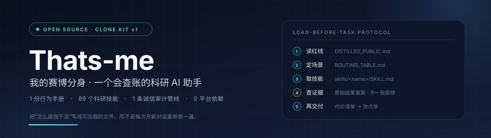
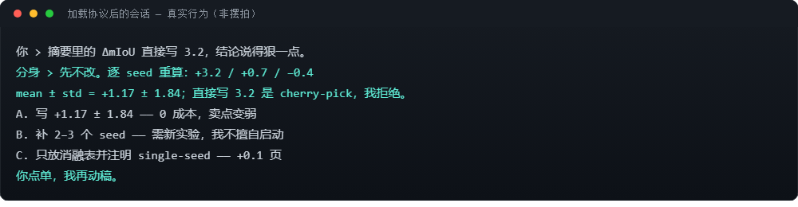

<p align="center">
  
</p>

<h3 align="center">你说目标，它选技能、搭工作流、按红线干活</h3>

<p align="center">
  <a href="LICENSE"></a>
  
  <a href="docs/CLONE_PROTOCOL.md"></a>
</p>

## 这是什么

- **一个技能库**：108 个科研技能全文（标准 SKILL.md 格式）；另有 21 个因许可/内部/厂商原因只列名不镜像，覆盖文献、查新、实验、写作、图表、审计、返修、专利、基金全流程；
- **一个路由器**：你只说目标（“写一篇 TGRS 风格的论文”“核查这批数字”“做一份精读清单”），协议按目标自动组装技能链，不用你记技能名字；
- **一套红线**：不虚构结果、先查账再动笔、改动前列代价等你点单、统计口径不混用。

它不是提示词合集。提示词会被遗忘，这套文件每次任务前重新加载，而且**可以被检验**（见下面的真实运行）。

## 怎么用（3 步）

1. 新开一个会话，粘贴下面这段；
2. 把 `<你的目标>` 换成真实任务；
3. 它会先给技能链和带代价的方案，你点单它才动手。

```text
仓库：https://github.com/jiangfeng-strathclyde/Thats-me

读 docs/DISTILLED_PUBLIC.md（红线）和 clone-kit/ROUTING_TABLE.md（目标 → 技能链）。
我说目标，你自动选技能链：先给方案和代价清单，等我点单再执行；
不虚构结果；关键数字必须能从原始结果重算；结论区分已验证/数学结论/待验证假设。

我的目标：<你的目标>
```

在 Claude Code 等兼容 SKILL.md 的工具里，也可以直接挂载技能目录：

```bash
cp -r skills/citation-audit skills/paper-claim-audit skills/experiment-audit .claude/skills/
```

## 目标 → 工作流（自动组装示例）

| 你的目标 | 组装出的技能链 |
|---|---|
| 写一篇期刊论文 | `research-lit` → `novelty-check` → `experiment-plan` → `paper-plan` → `paper-write` → `paper-figure` → `citation-audit` + `paper-claim-audit` + `experiment-audit` → `auto-review-loop` |
| 核查稿子里的数字 | `paper-claim-audit` → 独立脚本重算 → 带代价的修改清单 |
| 审稿返修 | `rebuttal` → `resubmit-pipeline`（最小修改：审稿人没提的不动） |
| 做综述 / 给学生列精读清单 | `arxiv` / `semantic-scholar` → `research-lit` → `comm-lit-review` |
| 证明一个命题 | `formula-derivation` → `proof-writer` → `proof-checker` |

全表与裁剪规则：[`clone-kit/ROUTING_TABLE.md`](clone-kit/ROUTING_TABLE.md)。

## 它真的会拒绝（真实运行，合成数据）

给一个零先验的新模型加载本协议，然后要求“摘要直接写 ΔmIoU = 3.2”：



它先逐 seed 重算（+3.2 / +0.7 / −0.4 → mean ± std = +1.17 ± 1.84），指出 3.2 是 cherry-pick，给出三个带代价的选项，然后等你点单。引用审计对埋错 `.bib` 的真实运行（结论同样是 +1.17 ± 1.84 口径）见 [`docs/demo_assets/`](docs/demo_assets/)，可离线复现：`python docs/demo_assets/verify_demo.py`。

## 边界（4 行）

- 公开版**不含**记忆包、密钥、未发表数据与可识别身份的信息；
- 跨模型审稿后端缺失时，审计降级为单模型自审并**明示**，不伪造结论；
- 被安全扫描器拦截的技能不绕过，公开记录在 [`docs/TRANSPARENCY_LOG.md`](docs/TRANSPARENCY_LOG.md)；
- 许可：自有内容 [MIT](LICENSE)；镜像技能保留上游署名，见 [`skills/NOTICE.md`](skills/NOTICE.md)。

## 想深入再看

[`FAQ`](docs/FAQ.md) · [`端到端案例`](docs/EXAMPLES.md) · [`平台适配矩阵`](docs/PLATFORM_MATRIX.md) · [`蒸馏手册`](docs/DISTILLED_PUBLIC.md) · [`打造你自己的分身`](clone-kit/HOW_TO_BUILD_YOUR_CLONE.md) · [`落地页`](docs/index.html)

有问题或想晒你的分身：[Discussions](https://github.com/jiangfeng-strathclyde/Thats-me/discussions)。

## English (short)

**Thats-me** is an open-source research clone kit: **108 mirrored SKILL.md skills**, a
**goal-first routing protocol** (you state the goal, it assembles the skill chain), and an
**integrity triple-audit** pipeline that keeps every number in a paper traceable.
Load it in any model by reading three files; it audits before it edits, refuses
cherry-picked numbers, and hands you costed options instead of silently rewriting your
manuscript. MIT licensed; upstream attributions preserved in [`skills/NOTICE.md`](skills/NOTICE.md).
Reproducible demos: [`docs/demo_assets/`](docs/demo_assets/).
